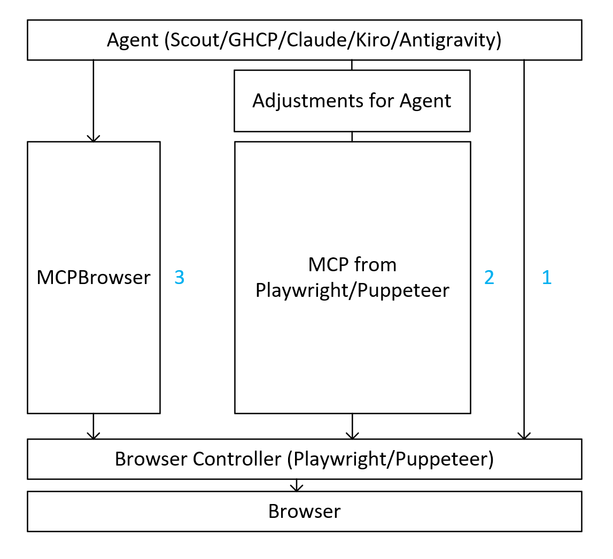

# The Missing Browser-Agent Layer

**Audience:** Teams building agents that interact with browsers  
**Date:** October 1, 2026

## Executive summary

Playwright provides a wide spectrum of browser controls. It is an excellent browser controller, but browser control alone is not an agent-ready capability.

There are three ways an agent can work with a browser:

1. **Agent directly controls Playwright.** Maximum control, but the agent must plan and orchestrate every browser operation. This is expensive in tokens, tool round trips, latency, and reasoning.
2. **Agent uses a generic browser MCP.** Tool schemas help, but a thin MCP wrapper still exposes mostly controller-level functions. The agent remains responsible for sequencing, state management, aggregation, failure handling, and deciding what to do next.
3. **Agent uses an agent-oriented aggregation layer.** Deterministic code handles browser orchestration, waits, checks, extraction, aggregation, and common edge cases. The agent receives a compact, structured result with the current state and suggested `nextSteps`.

**MCPBrowser demonstrates option 3.** It is a convenient, agent-oriented layer around browser controllers. It moves repeatable orchestration out of probabilistic model reasoning and into deterministic code.

For supported workflows, option 3 should be the fastest, least expensive, and most intuitive path. An agent platform should keep Playwright underneath and add this missing layer above it.

## Three paths from agent to browser



| Path | Agent responsibility | Token and latency cost | Result |
|---|---|---|---|
| **1. Direct controller access** | Select every operation, inspect every result, maintain state, retry, and verify success | **Highest** | Powerful but heavy for the agent |
| **2. Generic controller MCP** | Use MCP tools, but still sequence primitives, aggregate outputs, handle application logic, and choose recovery steps | **High** | Easier tool access, but much orchestration remains in the agent |
| **3. Agent-oriented layer** | State the task and act on a structured result or suggested next step | **Lowest for supported workflows** | Deterministic orchestration, an agent-ready response, and domain-specific plugins |

The important distinction is not MCP versus non-MCP. The distinction is **where the orchestration runs**:

- In options 1 and 2, orchestration is primarily performed by the agent through repeated model decisions.
- In option 3, recurring orchestration is implemented once in deterministic code and reused by every agent.

### Why option 3 is different

Option 3 is not only a shorter route to the same controller functions. It creates a reusable capability platform above the controller:

| Benefit | Why it matters |
|---|---|
| **Lower cost and latency** | Fewer model decisions, tool calls, snapshots, and round trips reduce token usage and cumulative latency. |
| **Higher reliability** | Waits, checks, retries, extraction, and known edge cases run in tested code instead of being reconstructed by the model for every task. |
| **Smaller context** | The agent receives relevant, aggregated content rather than every intermediate browser result. |
| **Clearer outcomes** | Structured responses distinguish success, partial success, retryable failure, terminal failure, and user action required. |
| **Guided continuation** | `nextSteps` tell the agent which actions are valid and useful from the current state. |
| **Consistent behavior across agents** | Different agents reuse the same orchestration instead of producing different plans for the same browser task. |
| **Central maintenance** | When a site changes, the deterministic layer or plugin is updated once rather than relying on every agent to rediscover the new interaction pattern. |
| **Better governance** | Semantic actions provide clearer approval, safety, telemetry, and audit boundaries than a long sequence of low-level clicks. |
| **Graceful fallback** | Plugins and high-level tools handle known workflows while Playwright controls remain available for unsupported cases and diagnostics. |
| **Domain extensibility** | Plugins can turn complex commercial web applications into discoverable, typed, task-level capabilities. |

## The orchestration tax

A controller-oriented workflow often requires the agent to:

1. Choose a browser operation.
2. Call the tool and wait.
3. Interpret the snapshot or operation result.
4. Update its plan.
5. Call another tool.
6. Repeat until it can infer that the user-level outcome succeeded.

Every cycle adds:

- Model input and output tokens.
- MCP and browser round trips.
- Snapshot or DOM content in the context window.
- Model inference latency.
- Opportunities to lose state or choose the wrong operation.
- More probabilistic reasoning for logic that could be deterministic.

A generic MCP interface improves discoverability and protocol compatibility, but wrapping controller functions one-for-one does not remove this orchestration tax.

## What MCPBrowser adds

MCPBrowser aggregates controller operations into task-oriented tools. Deterministic browser and in-page JavaScript handle common logic before returning control to the agent:

- Authentication, redirect, SSO, and human-login waiting.
- SPA readiness and content-stability checks.
- Domain-aware page and tab reuse.
- Clean HTML, text, or Markdown extraction.
- Main-content and selector-scoped extraction.
- Form discovery with fields, labels, constraints, and selectors.
- Multi-field input in one call.
- Post-action waiting and updated page extraction.
- Failure classification and recovery guidance.
- Typed MCP `structuredContent`, safety annotations, and actionable `nextSteps`.
- Application-specific plugins.

The agent receives a task-level outcome instead of every intermediate controller event.

```text
controller-oriented:
  operation -> result -> agent reasoning -> operation -> result
  -> agent reasoning -> operation -> result -> agent verifies

MCPBrowser:
  task request -> deterministic orchestration and verification
  -> structured result + current state + relevant content + nextSteps
```

## Concrete example: inspect and complete a form

A controller-oriented agent may need to navigate, wait, take a snapshot, inspect controls, derive selectors, fill each field, inspect the page again, submit, wait, and verify the outcome. Each stage can require another model decision and tool round trip.

MCPBrowser compresses the same workflow:

1. `browser_fetch_webpage` with `detectForms: true` loads the page and returns rendered content, structured forms, field selectors, page state, and `nextSteps`.
2. `browser_type_text` fills multiple fields in one call.
3. `browser_click_element` submits, waits for readiness, and returns updated content with `nextSteps`.

In many workflow stages, several controller-level calls become one MCPBrowser call. The exact ratio depends on the page, but the architectural benefit is consistent: orchestration runs in code rather than in repeated model turns.

## The response is part of the capability

An agent-friendly MCP tool should not merely return “click succeeded.” It should answer:

1. What happened?
2. Did the requested outcome succeed, partially succeed, fail, or require user action?
3. What is the current page or application state?
4. What relevant content or evidence was produced?
5. What can the agent safely do next?
6. Is approval or human interaction required?

MCPBrowser packages these answers into consistent MCP responses. This makes the tools easier for any MCP-capable agent to select and continue using correctly.

## A simple analogy

> **If an agent is a person, Playwright is a well-stocked pantry and a professional kitchen. MCPBrowser is the cook: it selects and combines the ingredients, prepares the dish, serves it in a form the agent can consume, and explains what can come next.**

Access to ingredients and tools is not the same as receiving a prepared dish. Likewise, access to browser controls is not the same as receiving an agent-ready browser capability.

- **Playwright supplies the ingredients and tools:** navigation, snapshots, selectors, clicks, typing, waits, and browser state.
- **MCPBrowser acts as the cook:** it orchestrates operations, handles common cases, verifies results, and packages the response.
- **The MCP response is the served dish:** structured, compact, immediately consumable, and accompanied by `nextSteps`.
- **Application plugins are recipes and domain expertise:** reliable ways to achieve application-specific outcomes without rediscovering the process for every task.

## Plugins go beyond browser control

Playwright can operate a Word or Excel web interface, but it does not define business operations such as:

- Read or replace a document range.
- Format a paragraph.
- Update a table cell.
- Add or resolve a comment.
- Read or write a worksheet range.
- Apply a formula, filter, sort, or cell format.
- Verify that the document or workbook is saved.

MCPBrowser's registered Word plugin already exposes 29 semantic document actions. An Excel plugin should expose workbook, worksheet, table, range, formula, filter, sort, chart, comment, recalculation, and save semantics.

These plugins move application knowledge out of the agent's prompt and into tested, deterministic code. They also create clearer approval and audit boundaries because the agent can reason about “update a workbook range” instead of reconstructing intent from a sequence of clicks.

### A plugin ecosystem for complex applications

Option 3 can host domain-specific plugins for any strategic application with a complex or frequently changing UI:

| Domain | Potential plugin targets | Example semantic capabilities |
|---|---|---|
| **Productivity** | Microsoft 365 (Office 365), Google Docs, Google Sheets, Google Slides | Read and edit documents, ranges, tables, formulas, comments, formatting, and save state |
| **Business intelligence** | Power BI, Tableau | Open reports, select filters, inspect visuals, extract data, change parameters, and export results |
| **CRM and sales** | Salesforce, Dynamics 365 | Find accounts and opportunities, update fields, create activities, progress workflows, and verify saves |
| **Enterprise operations** | SAP, ServiceNow, Workday | Complete governed forms and workflows, inspect status, update records, and handle approvals |
| **Developer and project systems** | Azure DevOps, GitHub, Jira | Query work, update items, manage pull requests, inspect pipelines, and perform workflow actions |
| **Other strategic web applications** | Any heavy UI selected by the platform team | Expose the application's most valuable operations as typed, discoverable agent capabilities |

A domain plugin is more than a collection of selectors. It understands:

- How to recognize the application, page, document, report, or record.
- Which semantic actions are available in the current state.
- How to translate an action into reliable browser operations.
- How to handle frames, virtualized controls, canvases, delayed rendering, and application-specific save behavior.
- How to verify that the requested business outcome occurred.
- Which operations are read-only, mutating, destructive, or approval-sensitive.
- What structured result and `nextSteps` the agent should receive.

The plugin hides UI mechanics from the agent while preserving Playwright as the execution foundation. The agent asks for “filter this Power BI report,” “update this Salesforce opportunity,” or “replace this Word document section”—not for a fragile sequence of coordinates, selectors, snapshots, and waits.

This also creates a scalable product model: platform owners can prioritize first-party plugins, partners can build governed adapters for their applications, and enterprises can add private plugins for internal line-of-business systems.

## Proposal for agent platforms

An agent platform should retain Playwright as its controller and add a **Browser Agent Capability Layer** with:

1. **Session and authentication orchestration:** identities, profiles, SSO, MFA/human handoff, redirects, tabs, and resumability.
2. **Agent-ready page understanding:** clean content, forms, tables, relevant regions, scroll state, and context budgets.
3. **Composite browser actions:** task-level tools that include waits, checks, extraction, and outcome verification.
4. **Consistent MCP responses:** typed results, status, evidence, current state, safety metadata, and `nextSteps`.
5. **Recovery logic:** retryable versus terminal failures, alternate strategies, and user-action-required states.
6. **Application Plugin SDK:** governed semantic actions for Word, Excel, Outlook, PowerPoint, SharePoint, and third-party applications.
7. **Playwright fallback:** direct primitives remain available for unsupported or diagnostic scenarios.

The preferred routing order should be:

1. Use a trusted application plugin when one supports the requested operation.
2. Otherwise use a high-level browser-agent tool.
3. Fall back to focused Playwright controls for unsupported interactions or diagnostics.
4. Use arbitrary browser code only as a controlled last resort.
5. Verify the user-visible outcome before reporting success.

## Recommendation

An agent does not need an alternative to Playwright. It needs a layer that understands both what the agent needs and how the browser controller works.

> **Agent reasoning and policy -> Browser Agent Capability Layer -> Application Plugins -> Playwright -> Browser**

That layer should move recurring checks, aggregation, waits, edge cases, and application logic from expensive model orchestration into fast deterministic code. It should then use MCP as an agent communication protocol—not merely as a wrapper around controller methods.

This is the value MCPBrowser demonstrates: **less orchestration for the agent, fewer tokens and round trips, lower latency, clearer results, and better guidance about what to do next.**

## Evidence

- [MCPBrowser server and MCP response handling](../MCPBrowser/src/mcp-browser.js)
- [Core action registry](../MCPBrowser/src/actions/index.js)
- [Fetch, extraction, and form aggregation](../MCPBrowser/src/actions/fetch-page.js)
- [Authentication orchestration](../MCPBrowser/src/core/auth.js)
- [SPA and page-readiness handling](../MCPBrowser/src/core/page.js)
- [Word plugin actions](../MCPBrowser/src/plugins/word/actions/index.js)
- [Playwright MCP](https://github.com/microsoft/playwright-mcp)

Claims about relative calls, tokens, and latency should be validated with a task benchmark. The architectural conclusion does not depend on a fixed ratio: deterministic aggregation removes repeated work from the agent for every supported workflow.
